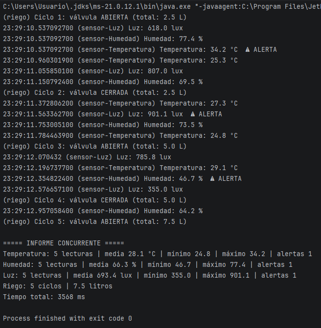

# Invernadero con hilos

José Miguel Gutiérrez López · 2.º DAM · Programación de servicios y procesos

## Qué hace
Es un invernadero simulado con 3 sensores que son temperatura, humedad y luz, y también un riego.
Cada sensor hace 5 lecturas con números aleatorios y saca una alerta si alguna se sale del rango.
El riego abre y cierra la válvula 5 veces y cada vez que abre echa 2,5 litros.

## Cómo ejecutarlo
Se abre el proyecto en IntelliJ con JDK 21 y se le da al play en el main de cada fase, que son Fase1_Secuencial, Fase2_Concurrente, Fase3_Experimentos y Fase4_Vigilante.

## Captura

## Resultados
| Ejecución | Fase 1 secuencial | Fase 2 concurrente |
|---|-------------------|--------------------|
| 1 | 11197 ms          | 3560 ms            |
| 2 | 11195 ms          | 3562 ms            |
| 3 | 11212 ms          | 3561 ms            |

La temperatura tarda 2 segundos porque son 5 lecturas de 400 ms, la humedad 3 segundos, la luz 2,5 segundos y el riego 3,5 segundos.
En la Fase 1 se suman todos y da unos 11 segundos, porque main los hace uno detrás de otro.
En la Fase 2 tarda lo que el más lento, que es el riego, unos 3,5 segundos, porque van todos a la vez.

## Análisis

### ¿Por qué compensa usar hilos en el invernadero?
Porque los sensores casi todo el rato están esperando en el sleep. Con un solo hilo, mientras uno espera no se hace nada más, y con un hilo para cada uno, mientras uno espera los otros siguen midiendo.

### Experimentos A, B y C
- **A:** si pido el informe justo después del start sale que todavía no hay lecturas, porque main no espera al hilo. Después del join ya salen las 5 lecturas.
- **B:** con run en vez de start sale main en el log, tarda unos 2100 ms y el estado final es NEW. Esto pasa porque no se crea ningún hilo y lo hace todo main como un método normal.
- **C:** al hacer start otra vez sale IllegalThreadStateException, porque un hilo solo se puede arrancar una vez y si ya ha terminado hay que crear otro.

### Estados observados
| Estado | Cuándo | Qué línea lo provoca |
|---|---|---|
| NEW | Antes de arrancar | new Thread sin hacer start |
| TIMED_WAITING | Casi siempre | Thread.sleep entre lectura y lectura |
| RUNNABLE | Pocas veces | Cuando mide o imprime |
| TERMINATED | Al acabar cada uno y al final | Cuando termina el run |

El programa termina aunque el vigilante tenga un while true porque lo he puesto como demonio con setDaemon antes del start, y así Java no lo espera para cerrar el programa.

### Thread frente a Runnable
| | extends Thread, que es el riego | implements Runnable, que son los sensores |
|---|---|---|
| Qué es | El hilo | La tarea |
| Cómo se arranca | riego.start() | new Thread con la tarea y luego start |
| Nombre del hilo | super("riego") | Se pone al hacer el new Thread |
| Herencia | Ya hereda de Thread | Puede heredar de otra clase como Sensor |

Los sensores solo pueden ser Runnable porque ya heredan de Sensor y en Java solo se puede heredar de una clase.
Para el riego elegiría Runnable, porque así la tarea va separada del hilo y queda libre la herencia.